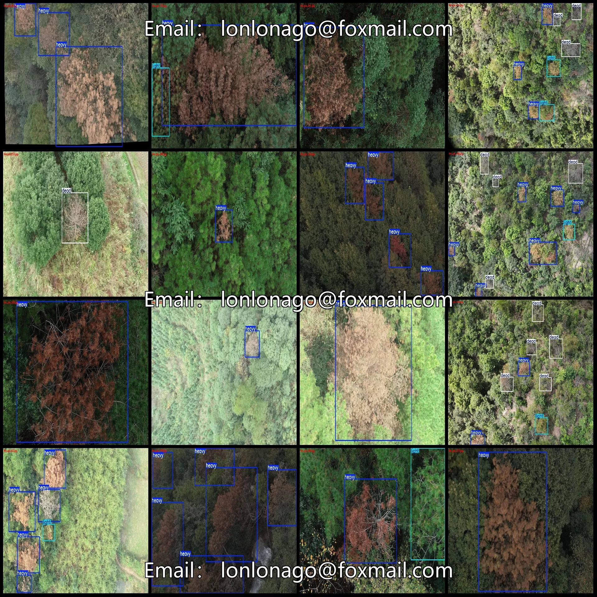
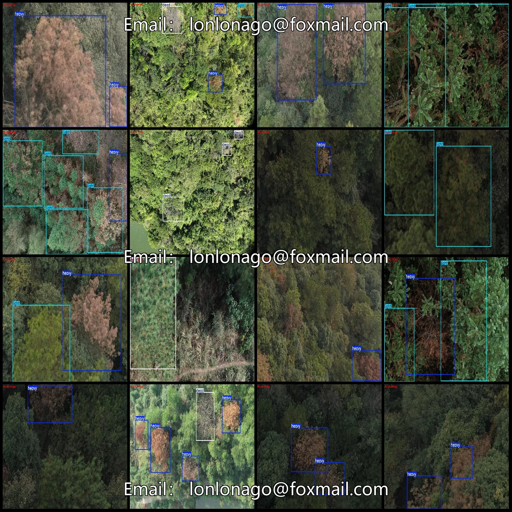
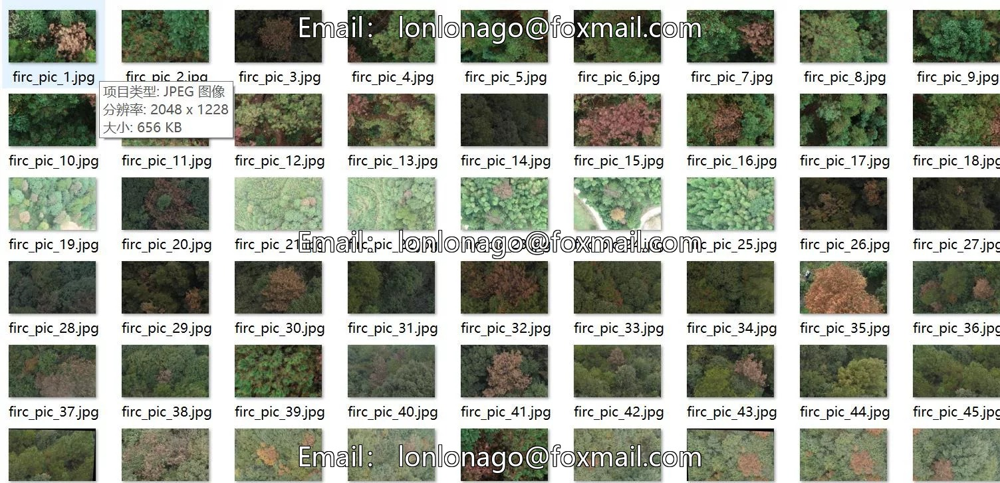
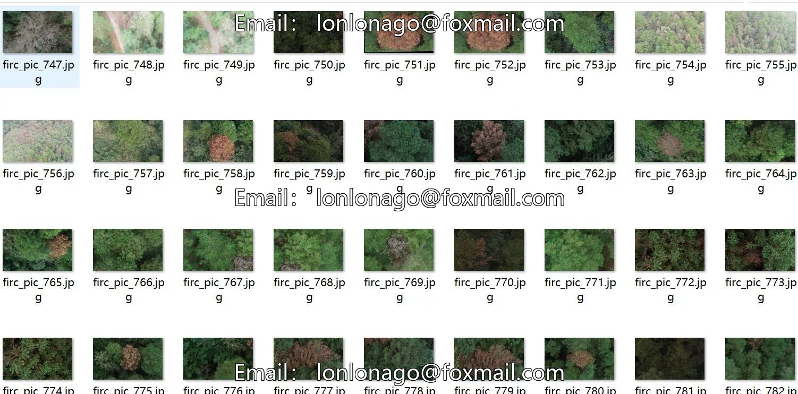
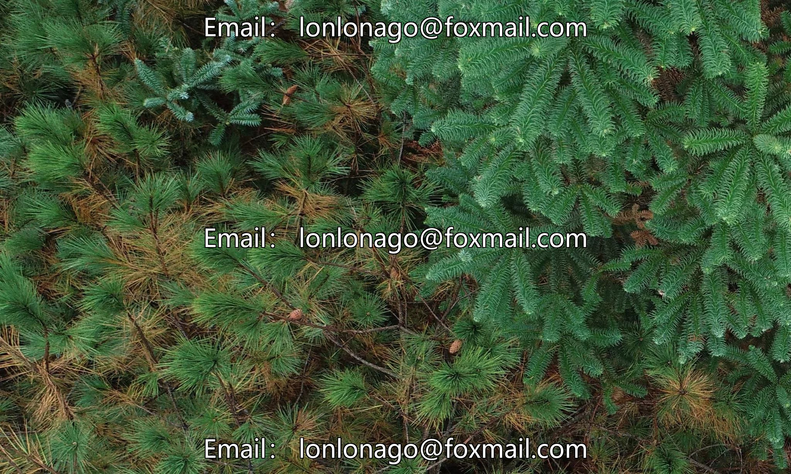
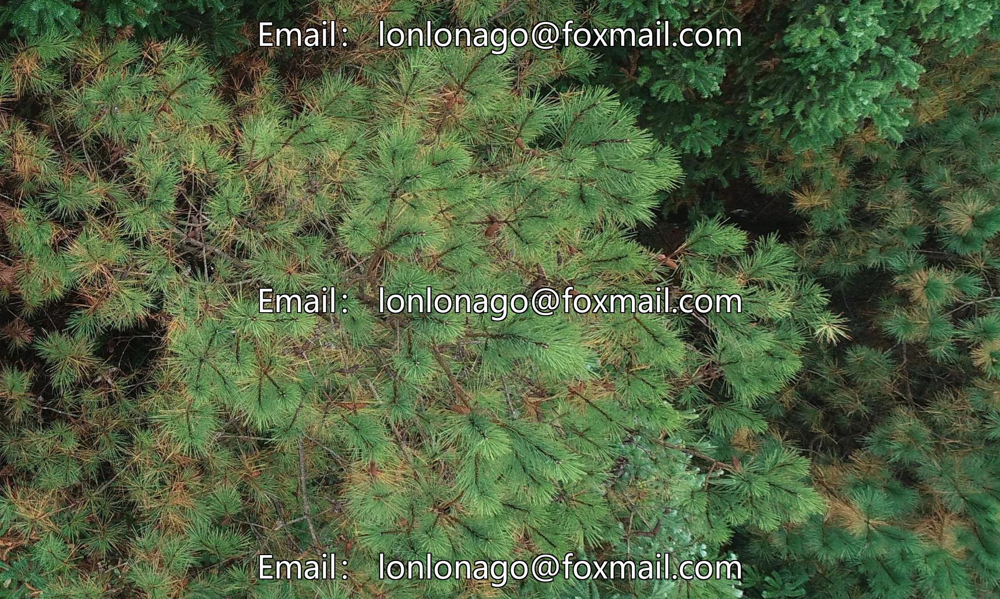
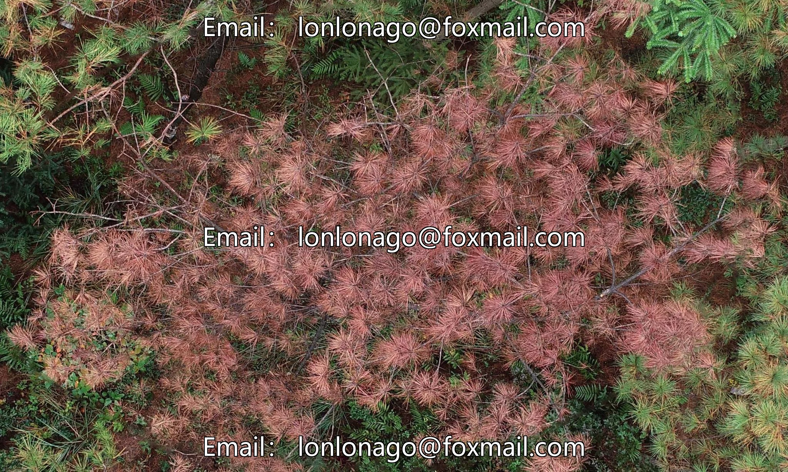

# Drone-view aerial photography dataset for detection of pine wilt disease stages in trees - VOC+YOLO format

## Body

Drone-view aerial photography dataset for detection of pine wilt disease stages in trees - VOC+YOLO format - 842 images in 3 categories
Warm Reminder: Due to the dataset's replicability, please confirm compliance with requirements before purchasing.
Dataset format: Pascal VOC format + YOLO format (txt file without split path, only containing jpg images and corresponding VOC format xml files and yolo format txt files)
Number of images (number of jpg files): 842
Number of annotations (number of xml files): 842
Number of annotations (number of txt files): 842
Number of annotation categories: 3

Annotation category names (Note that the order of categories in the YOLO format does not correspond to this, but is based on the classes.txt file in the labels folder): ["dead", "heavy", "light"]
Number of boxes per category
dead boxes = 546
heavy boxes = 1732
light boxes = 539
Total boxes: 2817
Number of images per category
dead images = 227
heavy images = 746
light images = 324
Image resolution: Multi-resolution images, such as 2048x1534, 2048x1228, etc.

Using labeling tool: labelImg
Labeling rules: Draw a rectangle around the category.
Important note: The dataset does not have separate training, validation, and test sets; you need to partition them yourself.
Special statement: This dataset does not guarantee the accuracy of the trained models or weight files.

## Images

## Payment

Here is a pay link on Stripe ( https://buy.stripe.com/3cs8yP7sY87d0vu9AB ). Please contact me lonlonago@foxmail.com after funding $89, and I will send you a complete data files , thank you!

